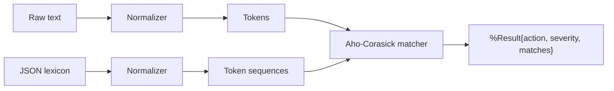

# KinyarwandaModeration

**Open-source Kinyarwanda content moderation, profanity filtering and hate-speech
detection for Elixir and Phoenix.**

[](https://github.com/niyonkuruelisa/kinyarwanda_moderation)
[](LICENSE)
[](https://elixir-lang.org)

Generic profanity filters are written for English and quietly fail on
Kinyarwanda. This library is built the other way around: the normalization
pipeline, the lexicon format and the matcher are all shaped by how Kinyarwanda
is actually written online. It has **zero runtime dependencies**.

The bundled word lists are detection patterns and nothing more. Read
[the disclaimer](#a-disclaimer-about-the-word-lists) before you use or quote
them; the same text travels with the data in
[`data/README.md`](data/README.md).

```elixir
KinyarwandaModeration.toxic?("some text")
#=> true | false

KinyarwandaModeration.check("some text")
#=> %KinyarwandaModeration.Result{
#     action: :review,
#     severity: :medium,
#     matches: [%KinyarwandaModeration.Match{term: "...", category_id: "..."}]
#   }
```

`toxic?/2` answers a yes/no question. `check/2` returns the full verdict: every
match, the category it belongs to, byte offsets back into the original string,
and a suggested action (`:allow`, `:flag`, `:review`, `:reject`). **Nothing ever
raises on toxic input** - moderation is a decision about content, not a
validation failure.

---

## Why not just a word list?

This is the part most multi-language filters get wrong. Kinyarwanda is
agglutinative and inconsistently spelled online, so exact substring matching
misses most real-world cases. Seven rules run on **both** the lexicon and
the incoming text, which is what keeps the two sides symmetric:

| Rule | What it fixes | Example |
| --- | --- | --- |
| **l / r folding** | Kinyarwanda has no native *l* in most positions, so writers swap *l* and *r* freely | `igiculu` and `igicuru` normalize to the same token |
| **Diacritic folding** | The orthography is unaccented but users type `é`, `á`, `è` anyway | `é` → `e` |
| **Double squashing** | A single doubled letter is the cheapest padding trick, and it slips past a rule that only looks for runs of three | `igiituba`, `igituuba`, `igitubba` all match a listed `igituba` |
| **Repeat collapsing** | Longer letter padding is a common evasion trick | `amaaani` → `amani` |
| **Noun-class prefix stripping** | Nouns inflect heavily by prefix (`umu-`, `aba-`, `iki-`, `ibi-`, ...) | `abadeputa` also matches a lexicon entry for `deputa` |
| **Augment dropping** | A locative or verb swallows the initial vowel of the noun it governs | `kugituba` matches a listed `igituba` |
| **Phrase gluing** | Writers run multi-word phrases together | `kanywenzobya` matches a listed `kanywe nzobya` |

Every rule is individually switchable - globally, or per-lexicon through the
`"normalization"` object in the data file.

Matching is [Aho-Corasick](https://en.wikipedia.org/wiki/Aho%E2%80%93Corasick_algorithm)
over **token sequences**, so a phrase never matches across a word boundary and
scanning stays linear in the length of the text as the lexicon grows. The
compiled automaton lives in `:persistent_term`, making reads lock-free on the
LiveView hot path.

### Where a listed word matches

There is no `contains`, `startswith` or `endswith` option, and none is needed:
every listed word already behaves like all three at once. Both sides are
expanded before they are compared, so a prefix the writer adds behaves like a
prefix on the listed word, and the listed word behaves like a stem.

| The writer typed | The lexicon lists | Matches? | Why |
| --- | --- | --- | --- |
| `igituba` | `igituba` | yes | exact token |
| `igituba` | `tuba` | yes | the listed word stems to `tuba` |
| `kugituba` | `igituba` | yes | augment dropping meets prefix stripping |
| `kanywenzobya` | `kanywe nzobya` | yes | phrase gluing |
| `uyumucumita` | `cumita` | **no** | the word is buried mid-token |
| `nywe nzobya` | `kanywe nzobya` | no | the leading token is missing |

The one shape the engine cannot see is a word glued into the **middle** of a
longer token (`cumita` inside `uyumucumita`), because the automaton walks tokens,
not characters. Listing the full inflected spelling, or adding the
augment-dropped stem as its own entry, is the supported way to catch those.



---

## A disclaimer about the word lists

> [!CAUTION]
> **Read this before you use the bundled data.**
>
> This repository contains Kinyarwanda words and phrases that are, in
> themselves, abusive. They are here as **detection patterns and nothing else**.
>
> **The list is not our opinion.** Including a term means "this string has been
> observed in abusive Kinyarwanda text", not that we endorse writing it, agree
> with what it expresses, or believe anything it implies. A lexicon entry is a
> mapping from spelling to a moderation decision. That is the whole of it.
>
> **The list is not a verdict about any person, group or community.** Many of
> these strings are ordinary Kinyarwanda words, names, place names and everyday
> parts of speech. Several carry meaning that changes entirely with context, and
> the same word can be affectionate, neutral or cruel depending on who is
> speaking and why. This library does not and cannot tell those apart. It reports
> that a string matched, and hands the decision to a human. Treat its output as a
> signal to look closer, never as a finding.
>
> **The list is not a substitute for judgement.** It is incomplete, it will
> contain items you disagree with, and it will miss things it should catch. It is
> a starting point that you are expected to review, edit and own before you rely
> on it. An automated filter should never be the only thing standing between a
> person and their account, their post or their reputation.
>
> **Do not copy this list into anything that presents it as a definition of what
> Kinyarwanda is, or of who Rwandans are.** Quoting these terms in documentation,
> training data, papers or datasets, or treating the filter's decisions as
> labels, misses what they are for and will misrepresent both the language and
> the people who speak it.
>
> If you maintain this list: add a term when it is genuinely used to harm people,
> not merely because it is crude. If you think an entry should not be here, that
> is a useful bug report, not an offence.

The same warning ships with the data itself, in
[`data/README.md`](data/README.md) and in the `"notice"` field of
`data/rw_lexicon.json`, so it travels with the words rather than only with this
page.

---

## Installation

```elixir
def deps do
  [
    {:kinyarwanda_moderation,
     git: "https://github.com/niyonkuruelisa/kinyarwanda_moderation.git", tag: "v0.1.0"}
  ]
end
```

Then `mix deps.get`. The OTP application installs the bundled lexicon at boot,
so there is nothing else to wire up.

To pin a mutable branch instead of a tag, use `branch: "main"` - but a tag makes
builds reproducible, and the whole point of keeping the lexicon in its own
repository is that you can bump one line in `mix.exs` to pick up new words.

---

## Usage

### Detect

```elixir
iex> KinyarwandaModeration.toxic?("just a normal sentence")
false

iex> KinyarwandaModeration.toxic?("")
false
```

### Inspect the verdict

```elixir
result = KinyarwandaModeration.check(user_input)

result.action           # :allow | :flag | :review | :reject
result.severity         # :low | :medium | :high | nil
result.matches          # [%KinyarwandaModeration.Match{}, ...]
result.lexicon_version  # "0.1.0" - record this to audit a decision later

KinyarwandaModeration.Result.category_ids(result)
```

### Redact for display

```elixir
result = KinyarwandaModeration.check(user_input, redact?: true)
result.redacted
#=> "well, [...] you"
```

### In an Ecto changeset

Moderation usually should not surface as a validation error to the user. Set a
status and let a moderator deal with it:

```elixir
defmodule MyApp.Posts.Post do
  use Ecto.Schema
  import Ecto.Changeset

  schema "posts" do
    field :body, :string
    field :status, :string, default: "published"
  end

  def changeset(post, attrs) do
    post
    |> cast(attrs, [:body])
    |> validate_required([:body])
    |> moderate_body()
  end

  defp moderate_body(changeset) do
    case get_change(changeset, :body) do
      nil ->
        changeset

      body ->
        case KinyarwandaModeration.check(body) do
          %{action: :allow} -> changeset
          %{action: :flag} -> put_change(changeset, :status, "published")
          %{action: :reject} -> put_change(changeset, :status, "rejected")
          %{action: :review} -> put_change(changeset, :status, "pending_review")
        end
    end
  end
end
```

### In a LiveView

Checking is pure and fast enough to run on every keystroke or message:

```elixir
def handle_event("send", %{"message" => body}, socket) do
  case KinyarwandaModeration.check(body) do
    %{action: :allow} -> {:noreply, stream(socket, :messages, [body])}
    %{action: action} -> {:noreply, assign(socket, :moderation, action)}
  end
end
```

---

## The lexicon is data, not code

Word lists change constantly, and reviewing them is a community job rather than a
coding job. So the lexicon is plain JSON, validated against
[`data/lexicon.schema.json`](data/lexicon.schema.json):

```json
{
  "version": "0.1.0",
  "locale": "rw",
  "normalization": { "fold_l_r": true, "squash_doubles": true, "augment_drop": true },
  "categories": [
    {
      "id": "insult",
      "label": "Insults",
      "severity": "low",
      "action": "flag",
      "terms": ["someword"],
      "phrases": ["some two word phrase"]
    }
  ]
}
```

Add a word: edit the JSON, bump `version`, open a pull request. No Elixir
required. If you only want a flat list of words, a plain
`["word", "another"]` array is also accepted - see
[`data/rw_hate_speech.json`](data/rw_hate_speech.json).

> [!IMPORTANT]
> The bundled `data/rw_lexicon.json` ships with **placeholder** entries only.
> It is a working example of the format, not a hate-speech list. Read the
> `"notice"` field inside it, and
> [`data/README.md`](data/README.md), before using this library for anything
> real.

### Bring your own lexicon

```elixir
# config/config.exs
config :kinyarwanda_moderation, lexicon: "/etc/moderation/rw_lexicon.json"
```

A missing or invalid configured lexicon is logged and the bundled default is used
instead, so bad config never takes your application down. Swap the file and call
`KinyarwandaModeration.reload/1` to pick up the change without a restart - or at
boot for a zero-downtime data update:

```elixir
{:ok, matcher} = KinyarwandaModeration.reload("/etc/moderation/rw_lexicon.json")
```

Operators can also tune the pipeline per call, which matters for short fields
like display names where precision beats recall:

```elixir
KinyarwandaModeration.check(name, strip_prefixes: false)
```

---

## API

| Function | Purpose |
| --- | --- |
| `KinyarwandaModeration.toxic?/2` | Boolean check |
| `KinyarwandaModeration.check/2` | Full verdict with matches and offsets |
| `KinyarwandaModeration.reload/2` | Load and install a lexicon at runtime |
| `KinyarwandaModeration.compile/2` | Install an in-memory lexicon map |
| `KinyarwandaModeration.normalize/2` | See exactly what the matcher saw |
| `KinyarwandaModeration.lexicon_version/0` | Version of the installed lexicon |
| `KinyarwandaModeration.lexicon_sources/0` | Paths a lexicon can be loaded from |

Full documentation is in the module docs; run `mix docs` to build them locally.

---

## Contributing

The most valuable contribution is **lexicon data**, and it does not require
writing Elixir.

1. Edit `data/rw_lexicon.json` (validated by `data/lexicon.schema.json`).
2. Bump `version` and `updated`.
3. Add tests to `test/` for any new normalization behaviour.
4. Run `mix precommit` and open a pull request.

Please open an issue before adding large batches of terms so the grouping and
severity levels can be discussed first.

## License

MIT - see [LICENSE](LICENSE).

## Keywords

`kinyarwanda` · `content-moderation` · `profanity-filter` ·
`hate-speech-detection` · `elixir` · `phoenix-framework` · `bad-words` ·
`text-sanitization` · `african-languages` · `nlp`
